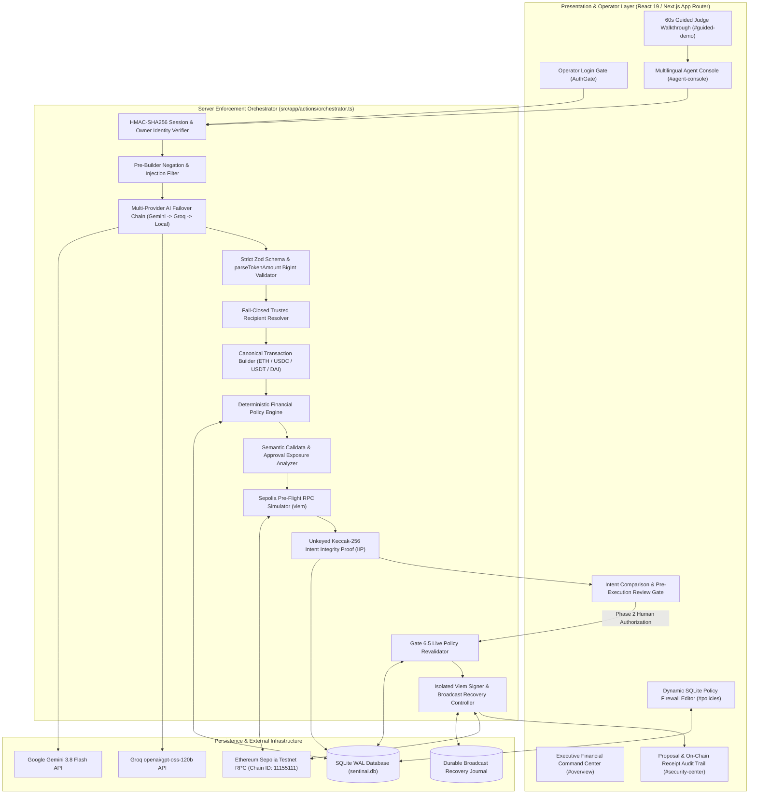

# System Architecture — SentinAI Guardian

**Project:** SentinAI Guardian — An AI-Native Autonomous Wallet with Deterministic Risk Control  
**Competition:** 2026 Shenzhen International FinTech Competition — International Track (Topic F: Agent Wallet / Autonomous On-chain Wallet)  

---

## 1. High-Level Architectural Overview

SentinAI Guardian is built on a **Two-Phase Deterministic Gated Architecture** that decouples **probabilistic natural-language intent interpretation** from **deterministic financial policy enforcement and cryptographic signing**.

---

## 2. Layered Component Breakdown

| Layer | Module Path | Responsibility |
|---|---|---|
| **Presentation Layer** | `src/app/page.tsx`, `src/components/agent/*`, `src/components/layout/*` | Renders live Sepolia telemetry, 60-second Guided Judge Walkthrough, 6-stage pipeline stepper, side-by-side User Intent vs. Actual Transaction comparison, Pre-Execution Review card, and SQLite policy/history editors. |
| **Authentication Layer** | `src/core/security/auth.ts`, `src/app/api/auth/*` | Verifies operator password using `crypto.timingSafeEqual`, issues `httpOnly` HMAC-SHA256 session cookies (`sentinai_session`) persisted in SQLite `sessions`, enforces per-IP login rate limits, and binds sessions to the operator ID. |
| **AI Intent Layer** | `src/core/ai/provider.ts`, `src/core/ai/intent-parser.ts`, `src/core/ai/security-explainer.ts` | Translates English, Bengali (`বাংলা`), and Banglish commands into structured JSON (`ParsedIntentSchema`) via `parseIntentWithProvenance` (`GeminiIntentProvider` → `GroqIntentProvider` → `MockIntentProvider`). |
| **Domain & Precision Layer** | `src/core/domain/schemas.ts`, `src/core/utils/financial.ts` | Enforces strict Zod schemas (`TRANSFER`, `APPROVE`, `QUERY_BALANCE`, `QUERY_NETWORK`, `UNKNOWN`) and exact integer `BigInt` decimal conversion via `parseTokenAmount(amount, decimals)` without floating-point rounding. |
| **Deterministic Policy Layer** | `src/core/policy/engine.ts`, `src/core/policy/user-policy.ts` | Evaluates every transaction candidate against SQLite-persisted `maxTransferAmountETH` (`1.0 ETH`), `allowUnlimitedApproval` (`false`), `trustedContacts`, and per-token `tokenApprovalPolicies` (`USDC`, `USDT`, `DAI`). |
| **Semantic Security & Simulation Layer** | `src/core/security/transaction-analyzer.ts`, `src/core/security/approval-analyzer.ts`, `src/core/security/simulator.ts`, `src/core/security/iip.ts` | Decodes raw calldata (`0xa9059cbb`, `0x095ea7b3`), detects unlimited/excessive token approvals, simulates execution on Sepolia (`eth_estimateGas` / `simulateContract`), and computes the unkeyed `keccak256(encodePacked(...))` Intent Integrity Proof digest. |
| **Persistence & Execution Layer** | `src/core/security/proposal.ts`, `src/core/execution/controller.ts` | Manages SQLite proposal state transitions (`PREPARED` → `AUTHORIZED` → `SUBMITTING` → `SUBMITTED` → `CONFIRMED`), atomic CAS locking, pre-broadcast recovery journaling, `21,000` gas floor enforcement, and Sepolia receipt reconciliation. |
