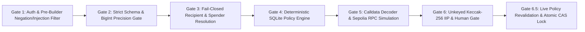

# Security Architecture — SentinAI Guardian

**Project:** SentinAI Guardian — An AI-Native Autonomous Wallet with Deterministic Risk Control  
**Competition:** 2026 Shenzhen International FinTech Competition — International Track (Topic F)  

---

## 1. Six-Gate Defense-in-Depth Pipeline

SentinAI Guardian enforces **six mandatory security gates** before a transaction proposal can be presented for human approval, plus a **seventh revalidation gate (Gate 6.5)** at execution time:



---

## 2. Key Architectural Security Invariants

### Invariant 1: Complete Signer Isolation from AI & Fixtures
- `broadcastTransaction` in [`src/core/execution/controller.ts`](../../src/core/execution/controller.ts) is the **only** function in the codebase that instantiates `privateKeyToAccount`.
- It is unreachable from `parseIntent`, `explainSecurityFindings`, `testSecurityFixtureAction`, or any read-only query (`QUERY_BALANCE`, `QUERY_NETWORK`).
- Security demonstration fixtures (`fixtures/security/index.ts`) are stored with `provenance = 'SECURITY_FIXTURE'` and `is_executable = 0`. Both `authorizeProposal` and `lockProposalForExecution` enforce `WHERE is_executable = 1 AND provenance = 'LIVE_VERIFIED'`.

### Invariant 2: Calldata vs. Semantic Intent Cross-Verification
- In [`src/core/security/transaction-analyzer.ts`](../../src/core/security/transaction-analyzer.ts), the analyzer independently decodes `candidate.data` and compares it against `intent`:
  - Native ETH transfers must have empty calldata (`0x`) and `candidate.value === expectedWei`.
  - ERC-20 `TRANSFER` must target a verified Sepolia token contract in `SUPPORTED_TOKENS` (`USDC: 0x1c7D4B196Cb0C7B01d743Fbc6116a902379C7238`, `USDT: 0x7169D38820dfd117C3FA1f22a697dBA58d90BA06`, `DAI: 0xFF34B3d4Aee8ddCd6F9AFFFB6Fe49bD371b8a357`), use selector `0xa9059cbb`, and have `candidate.value === 0n`.
  - ERC-20 `APPROVE` must use selector `0x095ea7b3`, have `candidate.value === 0n`, and pass `analyzeApprovalExposure()` without blocking mismatches.

### Invariant 3: EIP-2780 Intrinsic Gas vs. 21,000 Broadcast Gas Floor
- On Ethereum Sepolia, `eth_estimateGas` for a self-transfer (`from === to`) returns `12,000` gas due to warm-account access pricing.
- However, a top-level Ethereum transaction requires at least `21,000` intrinsic gas at broadcast (`G_transaction = 21000`).
- [`src/core/execution/controller.ts`](../../src/core/execution/controller.ts) enforces `MIN_STANDARD_TX_GAS_LIMIT = 21000n`:
  ```ts
  const effectiveGasLimit = gasEstimate > MIN_STANDARD_TX_GAS_LIMIT ? gasEstimate : MIN_STANDARD_TX_GAS_LIMIT;
  ```
  This was verified on-chain in Sepolia Transaction `0xfe315950001536c94f363c6e7b6522eef69a2b874d958544dd91efe5ee8388da` (`gasLimit = 21000`, `gasUsed = 12000`, `status = 0x1`).

### Invariant 4: Atomic Compare-And-Swap (CAS) & Crash Recovery
- Concurrent execution attempts on the same proposal are serialized by SQLite's ACID transaction engine:
  ```sql
  UPDATE proposals
  SET status = 'SUBMITTING'
  WHERE id = ? AND owner_id = ? AND status = 'AUTHORIZED' AND is_executable = 1 AND provenance = 'LIVE_VERIFIED'
  ```
- Before `sendTransaction` is invoked over the network, `writeBroadcastRecoveryJournal` writes the proposal ID, sender, recipient, value, and timestamp to disk so any mid-broadcast crash or timeout can be reconciled via `findMatchingBroadcastTxOnChain` without risking a duplicate broadcast.
