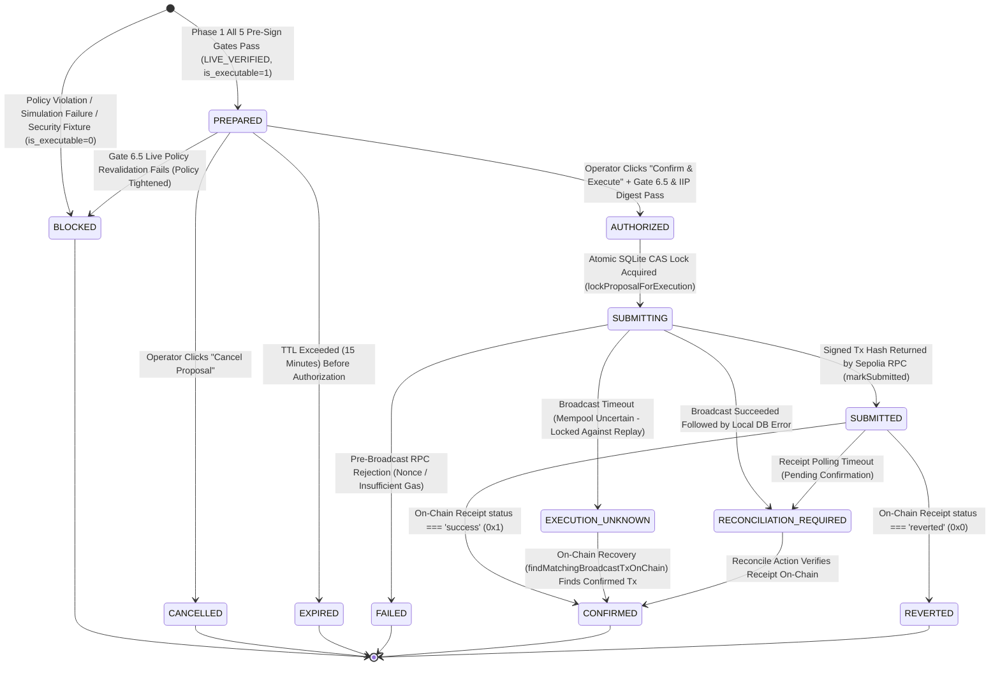

# Execution State Machine — SentinAI Guardian

**Project:** SentinAI Guardian — An AI-Native Autonomous Wallet with Deterministic Risk Control  
**Implementation File:** [`src/core/security/proposal.ts`](../../src/core/security/proposal.ts) & [`src/app/actions/orchestrator.ts`](../../src/app/actions/orchestrator.ts)

---

## 1. Formal Proposal Lifecycle State Diagram

---

## 2. State Transition Rules & Replay Guarantees

| State | Executable? | Terminal? | Transition Preconditions |
|---|---|---|---|
| `PREPARED` | Yes (`1`) | No | Created only when `provenance === 'LIVE_VERIFIED'`, `policyDecision.allowed === true`, `simulation.success === true`, and `analysis.canExecute === true`. |
| `BLOCKED` | No (`0`) | **Yes** | Assigned to policy-violating proposals and all `SECURITY_FIXTURE` scenarios. Cannot transition to `AUTHORIZED` or `SUBMITTING`. |
| `CANCELLED` | No | **Yes** | Explicitly cancelled by the authenticated owner while in `PREPARED` state. |
| `EXPIRED` | No | **Yes** | Automatically assigned when `Date.now() > Date.parse(proposal.expiresAt)` (default TTL: 15 minutes). |
| `AUTHORIZED` | Yes (`1`) | No | Requires valid owner session, non-expired TTL, passing Gate 6.5 live policy revalidation, and passing `verifyIIPDigest`. |
| `SUBMITTING` | Locked | No | Acquired via atomic SQLite CAS (`WHERE status = 'AUTHORIZED'`). Only one caller can ever enter `SUBMITTING`. |
| `SUBMITTED` | Locked | No | Entered once `broadcastTransaction` returns a `0x` transaction hash; `tx_hash` is persisted in SQLite. |
| `CONFIRMED` | No | **Yes** | Entered when `waitForReceipt` confirms `receipt.status === 'success'` on Ethereum Sepolia. |
| `REVERTED` | No | **Yes** | Entered if the transaction was mined on-chain with `receipt.status === 'reverted'`. |
| `FAILED` | No | **Yes** | Entered only when `broadcastTransaction` deterministically fails *before* reaching the mempool. |
| `EXECUTION_UNKNOWN` | Locked | Non-Replayable | Entered if the RPC connection drops during `sendTransaction`. Prevents retry double-spends until reconciled via on-chain block scan. |
| `RECONCILIATION_REQUIRED` | Locked | Non-Replayable | Entered if a broadcast succeeded (`txHash` known) but receipt polling timed out or post-broadcast DB write failed. |
