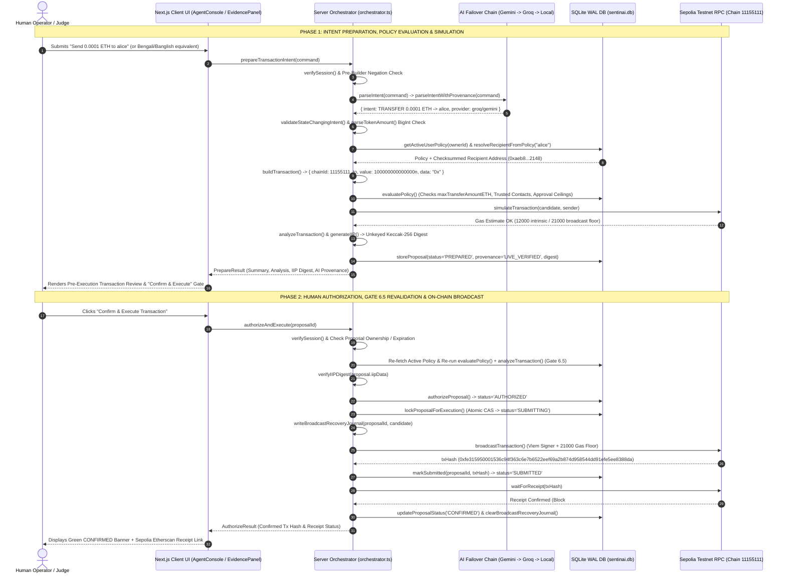
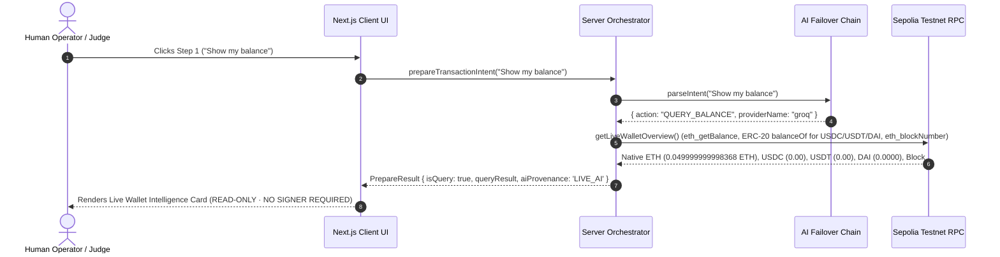

# Data Flow & Sequence Diagrams — SentinAI Guardian

**Project:** SentinAI Guardian — An AI-Native Autonomous Wallet with Deterministic Risk Control  
**Competition:** 2026 Shenzhen International FinTech Competition — International Track (Topic F)  

---

## 1. End-to-End Two-Phase Transaction Sequence

---

## 2. Read-Only Intelligence Query Sequence (`QUERY_BALANCE` / `QUERY_NETWORK`)

